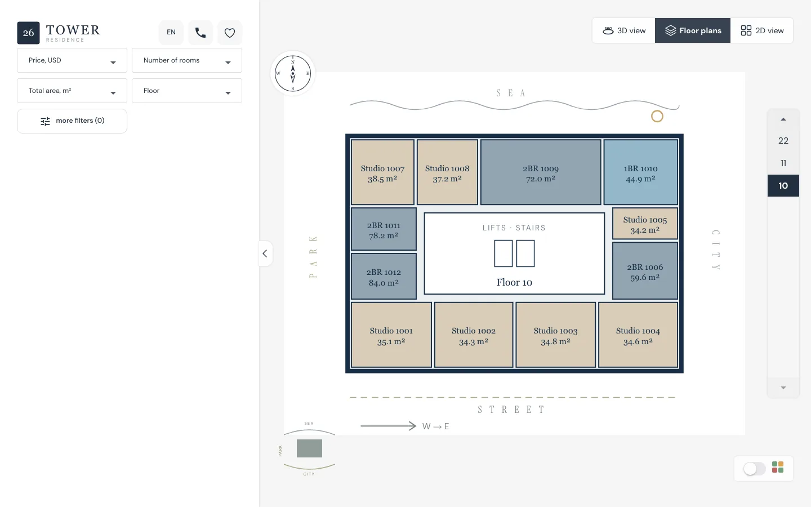
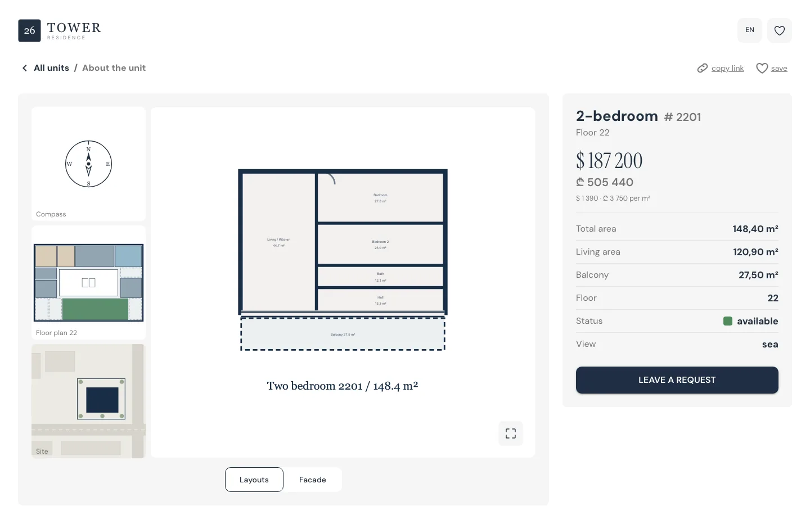
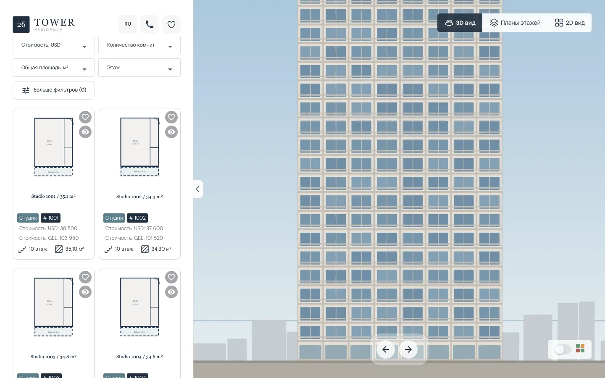

# apartment-picker

Sales site with an apartment picker for a 26-storey residential tower: landing, 3D facade view, floor plans, a 2D sales grid and unit pages.

It is the front end of a sales site for a 26-storey tower of about 280 apartments (codename Tower 26). It is for a developer's sales team and their buyers: a buyer filters units, finds one on the facade or a floor plan, opens its page and leaves a request.



This repo ships a sample of 3 floors (10, 11 and 22) with 32 units, so it runs locally with no backend. Floor and unit plans in the sample are schematic.

| Unit page | 3D view with unit hit areas |
| --- | --- |
|  |  |

## Key technical decisions

- No build step. Plain HTML, CSS and vanilla JS: 7 scripts with 1,600 lines (133 KB) of JS and 111 KB of CSS, unminified. Any static host serves it.
- One data file for the inventory. `data/units.js` sets `window.DATA` with one record per unit: floor, slot, living, balcony and total area, type, price, status, view. The full site has about 280 records; the sample has 32.
- Floor plans load per floor. The first version put every floor into one `plans.json`. On the full site each floor is an 8 to 11 KB JSON file (`data/floors/floor-N.json`, 25 files, 263 KB in total), fetched on demand. The floors above and below (F+1, F-1) are prefetched, so the floor stepper does not wait for the network. A floor with no JSON file, which is every floor in this sample, gets a schematic plan drawn by `js/plans.js`.
- On the full site, hit areas are polygons in the plan's pixel space. Each unit has a contour, a footprint and its balconies (the full site has 349 balcony polygons). The plan is a raster image under an SVG overlay, so the image can be downscaled without touching the geometry. Wheel zoom works on the SVG viewBox, 1x to 6x, with drag to pan and double click to reset.
- Plan images are shared. On the full site, about 280 units use 95 plan images: units with the same layout on different floors point to one WebP (`data/plans.js`).
- The 3D view is a canvas with 3 frames. The first frame carries an SVG grid of unit hit areas: 8 bays by 10 floors. Frames load only when the 3D view is open.
- State survives a reload. Language, view (3D or floor plans), floor, filters and favourites go to localStorage, mirrored in a cookie (SameSite=Lax, 180 days). Routing uses the URL hash: `#/`, `#/floors`, `#/own/<unit id>`, `#/favorites`.
- Two languages. RU and EN strings live in `js/i18n.js`, about 200 keys per language; `?lang=en` switches the landing.
- Lead capture is a hook, not a dependency. `js/config.js` holds `leadTrackerSrc`. When it is empty, forms show an offline message and nothing leaves the browser. When set, the script must provide `window.leadTracker.lead(payload)` and `window.leadTracker.units(callback)`; the second one pushes live unit statuses into the picker.
- Inventory comes from the architect's PDF. `tools/parse_units.py` reads the area table of every unit on 25 floor-plan pages with pypdf, maps each table to 1 of 12 fixed slots by its page coordinates, repairs misread areas with `total = living + balcony` (0.15 m2 tolerance) and compares per-floor sums with the official area table.

## Structure

```
index.html              landing page (dark theme)
select.html             apartment picker: 3D view, floor plans, 2D grid, unit pages
css/tokens.css          design tokens for both themes
css/app.css             picker layout and components
css/landing.css         landing layout
js/config.js            per-deployment settings: lead tracker URL
js/state.js             state persistence (cookie + localStorage)
js/util.js              DOM helpers, formatting, icons, favourites
js/i18n.js              RU and EN strings
js/plans.js             unit plans, floor plans, facade hit areas
js/app.js               picker: filters, views, routing, unit page, lead form
js/landing.js           landing: catalogue cards, consultation form
data/units.js           unit inventory (sample: floors 10, 11, 22)
data/plans.js           unit number -> plan image, floor index, units with a PDF (empty in the sample)
assets/img/             placeholder renders of the tower and site
tools/parse_units.py    architect PDF -> data/units.js
tools/render_placeholders.py  draws the images in assets/img
tests/                  pytest tests for the parser
docs/                   screenshots for this README
```

Code comments and some UI strings are in Russian; they are working artifacts of the project.

## Run it

The site is static. Serve the repo root and open it in a browser:

```
python3 -m http.server 8000
```

- Landing: http://localhost:8000/
- Picker: http://localhost:8000/select.html
- A unit page: http://localhost:8000/select.html#/own/22-3

The parser and the image script use [uv](https://docs.astral.sh/uv/):

```
uv sync
uv run pytest                          # 8 tests, no PDF needed
uv run tools/render_placeholders.py    # redraws assets/img/*.webp
```

The parser needs the architect's floor-plan PDF, which is not in this repo:

```
uv run tools/parse_units.py --pdf path/to/plans.pdf --out /tmp/units.js
```

`tools/parse_units.config.json` holds the page range, the 12 slot coordinates, the official per-floor areas and the project block. The official areas are empty here; add `"floor": [living, balcony]` pairs from the PDF's area table to get the per-floor comparison. Writing to `data/units.js` replaces the curated sample. The tests cover the parser with synthetic tables and a synthetic PDF.

## Data in this repo

- Prices and views are generated placeholders from `tools/parse_units.py`, not the developer's price list. In the sample every status is set to available, and room types were re-derived from the plans, so a fresh parser run differs in type and status.
- Developer, architect, address, cadastre and permit numbers are placeholders.
- The tower and site images are schematic renders drawn by `tools/render_placeholders.py`. They replace the project photos and renders, which are not published here.
- Floor plans and unit plans are schematic: `js/plans.js` draws them from the unit areas. The real layouts are not published here.

## Status

Working prototype. Before a public launch it needs the developer's price list and a production lead tracker.

## License

MIT, see [LICENSE](LICENSE). Author: Lev Skorokhodov.

Some icons: Material Icons, Apache License 2.0.
